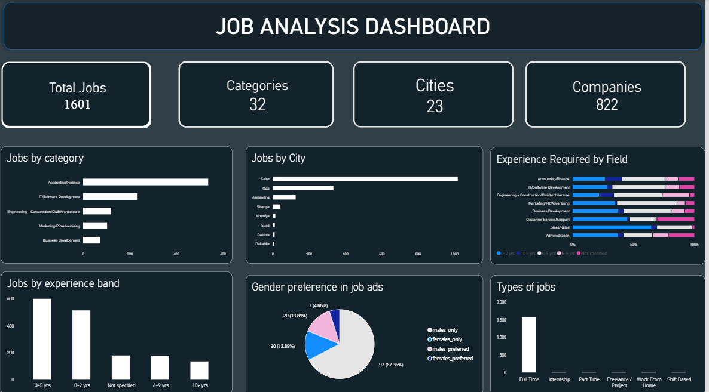

# Job Market Analysis: Egypt

An end-to-end data analysis project exploring about 1,600 job postings in Egypt:
which fields hire the most, where the jobs are, and how much experience
employers ask for.

## Tools
Python (pandas) · SQL (SQLite) · Power BI · Google Colab

## Dataset
[Wuzzuf Data Analyst jobs] from Kaggle:[https://www.kaggle.com/datasets/ahmedabbas757/wuzzuf-data-analyst-jobs]

The raw data had 1,617 job postings with job title, company, location, job type,
experience level, experience years and skills.

## Process

**1. Data cleaning (Python / pandas)**
- Removed 16 duplicate rows, leaving 1,601 postings.
- Fixed 179 rows where the job category had shifted into the experience column.
- Created a clean `city` column from the location text (neighborhoods rolled up
  into their city).
- Created a `category` column from the skills field and separated gender-preference
  tags (such as males_only) into their own `gender_pref` column.
- Converted experience text (for example "3 - 5 Yrs of Exp") into numeric
  `exp_min` and `exp_max` columns and grouped them into experience bands.

**2. Analysis (SQL)**
- Loaded the cleaned data into SQLite inside the notebook and ran SQL queries to
  group and rank jobs by field, city, experience band and company.

**3. Dashboard (Power BI)**
- Built a dashboard with KPI cards (total jobs, categories, cities, companies)
  and charts for jobs by field, city, experience band, experience required by
  field, gender preference and job type.

## Key insights
1. **Greater Cairo dominates hiring:** Cairo (63.6%) and Giza (20.9%) together
   hold about 84.5% of postings.
2. **Finance leads in volume:** Accounting/Finance has 537 of 1,601 postings, but
   only 30.5% of those roles are open to 0-2 years of experience.
3. **Most fresher-friendly fields (by share):** Sales/Retail (66%) and Customer
   Service/Support (65%).
4. **Experience demands vary by field:** Logistics asks for 5.6 years on average,
   while Customer Service asks for 2.2.
5. **Hiring is spread across many employers:** the top employer has only 15
   postings, out of 822 companies.
6. **Gender-specific ads are a small slice:** 91% of postings mention no
   preference. Among those that do, male-targeted ads outnumber female-targeted
   ones by about 4 to 1.

## Limitations
- The dataset appears to have been collected by searching for "analysis", so
  finance roles are over-represented. Findings describe this dataset, not the
  whole job market.
- About 11% of postings had no experience information and were left out of the
  experience analysis.
- The dataset has no salary data.

## Files
- `job_market_analysis.ipynb`: data cleaning, SQL queries and analysis
- `clean_jobs.csv`: cleaned dataset used for the dashboard
- `analysis_dashboard.pbix`: Power BI dashboard (open with Power BI Desktop)
- `image.png`: dashboard screenshot
